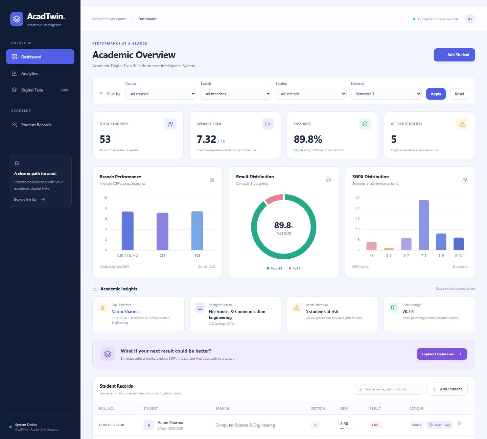
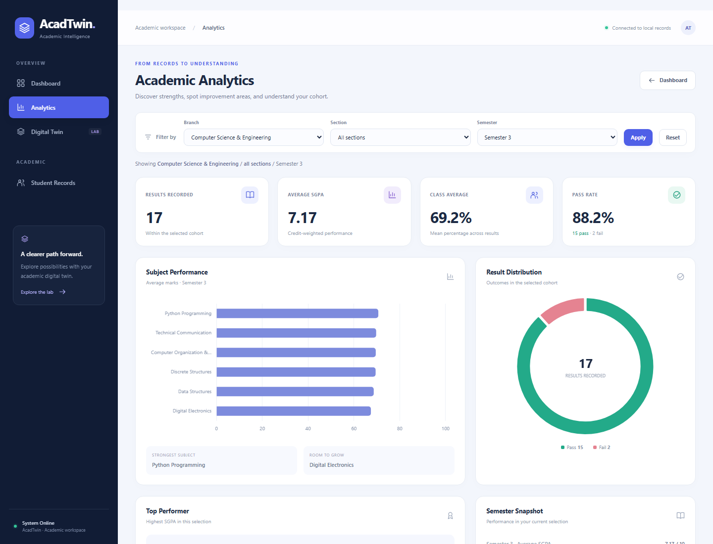

# AcadTwin

**Academic Digital Twin & Performance Intelligence System**

AcadTwin is a Flask + SQLite academic intelligence prototype that goes beyond storing student results. It combines student/result management, credit-weighted SGPA calculations, descriptive analytics, a non-destructive **Academic Digital Twin**, a target-SGPA solver, and explainable rule-based recommendations.

> **Record → Analyze → Simulate → Optimize → Explain**

## Preview

### Academic intelligence dashboard



### Branch and subject analytics



> The screenshots are from the development build. The public repository intentionally generates a fresh fictional demo dataset locally instead of committing student records.

## What makes AcadTwin different?

A conventional student-management project mainly stores and retrieves records. AcadTwin also lets a user inspect performance patterns and create a **temporary simulated academic state**. Hypothetical marks can be changed and recalculated without writing those values back to the real result tables.

The Digital Twin can answer questions such as:

- What happens to SGPA if marks improve in selected subjects?
- Which grade threshold gives useful credit-weighted impact?
- What subject improvements could move a scenario toward a target SGPA?
- Does the simulated scenario still contain a failed subject?

The current implementation is deterministic and explainable. It does **not** claim machine-learning prediction.

## Features

- Modern responsive Flask dashboard
- Course, branch, section and student records
- Student CRUD operations
- Branch-specific subject configuration
- Semester result entry and replacement
- Project-defined grades and grade points
- Credit-weighted SGPA and percentage calculation
- PASS/FAIL evaluation
- Student academic profiles
- Branch/section filtering
- Dashboard charts and academic insights
- Subject-performance analytics and rankings
- Academic risk badges
- **Academic Digital Twin / what-if simulation**
- Actual-vs-simulated marks chart
- **Target SGPA solver** based on discrete grade thresholds and credits
- Explainable rule-based recommendations
- Validation and graceful error states
- 26 automated regression/integration tests

## Technology stack

| Layer | Technology |
| --- | --- |
| Backend | Python, Flask |
| Database | SQLite |
| Frontend | HTML, Jinja, CSS, JavaScript |
| Charts | Chart.js via CDN |
| Testing | Python `unittest`, Flask test client |
| Version control | Git / GitHub |

## Quick start

### 1. Clone and enter the repository

```bash
git clone <your-repository-url>
cd AcadTwin
```

### 2. Create a virtual environment

Windows PowerShell:

```powershell
python -m venv .venv
.\.venv\Scripts\Activate.ps1
```

macOS/Linux:

```bash
python3 -m venv .venv
source .venv/bin/activate
```

### 3. Install the dependency

```bash
python -m pip install -r requirements.txt
```

### 4. Generate a fictional demo database

```bash
python setup_demo.py
```

This creates `acadtwin.db` locally with **48 fictional demo students** across three prototype branches and six Semester 3 sections. The database is intentionally ignored by Git.

To deliberately rebuild the local demo database later:

```bash
python setup_demo.py --reset
```

### 5. Run AcadTwin

```bash
python app.py
```

Open `http://127.0.0.1:5000` in a browser.

Charts use Chart.js from a CDN, so chart rendering requires an internet connection.

## Demo flow

1. Open the **Dashboard** and inspect SGPA, pass rate, risk count and charts.
2. Filter the cohort by branch or section.
3. Open **Analytics** and inspect subject performance and rankings.
4. Open a student profile with a recorded result.
5. Select **Open Academic Twin**.
6. Change two or three simulated marks and run the simulation.
7. Compare actual and simulated SGPA, percentage and subject marks.
8. Enter a target SGPA and calculate a threshold-based path.
9. Review the credit-aware recommendations.
10. Return to the real student profile and confirm that the stored marks are unchanged.

## Academic rules

These are **project-defined prototype rules**, not an official university grading policy.

| Marks | Grade | Grade point |
| --- | --- | ---: |
| 90–100 | A+ | 10 |
| 80–89 | A | 9 |
| 70–79 | B+ | 8 |
| 60–69 | B | 7 |
| 50–59 | C | 6 |
| 40–49 | D | 5 |
| 0–39 | F | 0 |

**SGPA**

```text
Σ (Grade Point × Subject Credits)
─────────────────────────────────
        Σ Subject Credits
```

A subject below 40 produces a FAIL result in the prototype.

The shared academic rules live in `academic.py`, so stored-result calculations and Digital Twin calculations use the same grading model.

## Digital Twin design

The real academic record remains the source of truth. The Twin route loads the stored subject state, creates a temporary scenario, applies hypothetical marks, and recalculates performance using the shared academic engine.

**Simulation values are not inserted into or used to update the real result tables.**

The target solver is also deterministic. It evaluates the next available grade thresholds and subject credits, then proposes a scenario that moves toward the requested SGPA. It reports targets that are already satisfied or unreachable instead of pretending to guarantee future performance.

## Testing

Create the fictional demo database first, then run:

```bash
python -m unittest discover -s tests -v
```

The suite contains **26 tests** covering academic rules, student CRUD, result replacement, validation, dashboard/analytics filtering, chart payloads, Digital Twin non-mutation, target solving and error states.

A regression case uses marks:

```text
95, 85, 75, 65, 55, 35
```

with credits:

```text
3, 4, 2, 4, 4, 3
```

Expected result:

```text
Percentage: 68.33%
SGPA:       6.70
Result:     FAIL
```

GitHub Actions runs the same test suite against a freshly generated fictional demo database.

## Project structure

```text
AcadTwin/
├── app.py                  # Flask routes and application workflows
├── academic.py             # grades, SGPA, risk, Twin and target-solver logic
├── database.py             # SQLite schema and connection helper
├── setup_demo.py           # safe local demo-database setup
├── populate_demo.py        # fictional demo students/results
├── demo_results.py         # optional DEMO result regeneration
├── requirements.txt
├── templates/
│   ├── base.html
│   ├── index.html
│   ├── analytics.html
│   ├── student.html
│   ├── twin.html
│   └── error.html
├── static/
│   ├── css/
│   ├── js/
│   └── favicon.svg
├── tests/
│   └── test_acadtwin.py
├── docs/
│   └── screenshots/
└── .github/workflows/tests.yml
```

## Privacy and repository hygiene

The public repository does not include the original local SQLite database, the old JSON student file, browser profiles, test artifacts, Python caches or personal machine paths. Demo data is generated from fictional names by `setup_demo.py`.

`.gitattributes` normalizes source files to LF line endings so Windows CRLF conversions do not create a repository full of false modifications.

## Development evolution

AcadTwin evolved through several iterations:

```text
Python CLI / JSON
        ↓
Tkinter desktop prototype
        ↓
Flask web application
        ↓
SQLite relational model
        ↓
Performance analytics
        ↓
Academic Digital Twin
```

The public repository focuses on the current Flask implementation rather than carrying personal/local legacy data forward.

## Scope

AcadTwin is an educational prototype. Current analytics are descriptive and recommendations are deterministic/rule-based. Future extensions could include multi-semester CGPA trends, authentication and roles, attendance/assignment integration, report export and carefully evaluated predictive models.
